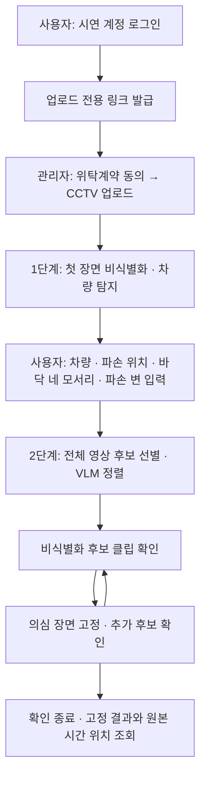
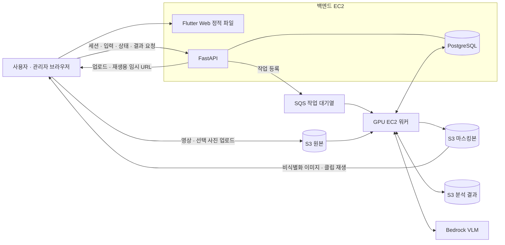

# 마스킹 기반 주차장 CCTV 후보선별 서비스

사건 시점을 모르는 긴 주차장 CCTV에서 **차량 파손과 관련된 후보 구간을 찾고, 사용자가 비식별화된 영상을 직접 확인하는 웹 서비스**입니다. 대학교 종합설계 과목의 3인 팀 프로젝트로, PC 웹 기반 데모·시연을 목표로 합니다.

사용자가 지정한 차량·파손 위치를 바탕으로 후보를 선별하고, VLM이 검토 순서를 정합니다. 사용자는 의심 장면을 고정하고 업로드 원본에서의 시간 위치를 확인할 수 있습니다. 최종 사건 판단은 사용자가 합니다.

> **현재 상태 — 2026-10-09:** 이 저장소에는 요구사항·설계 문서와 `fixtures/.gitkeep`이 있습니다. 서비스 코드, 의존성 파일, 로컬 DB 설정, 테스트 자료 및 배포 워크플로는 아직 없습니다. 아래 서비스 동작과 개발·배포 구성은 최신 명세 기준이며, 실행 명령은 구현 후 검증하여 추가할 예정입니다.

## 주요 기능

- **시연 계정과 업로드 링크:** 사용자가 발급한 일회용 링크로 주차장 관리자가 로그인 없이 위탁계약에 동의한 뒤 CCTV를 업로드합니다.
- **차량·파손 정보 입력:** 비식별화된 첫 장면에서 차량, 파손 위치, 차량 바닥 네 모서리와 파손 변을 지정합니다. 파손 사진·설명은 선택 입력입니다.
- **후보 선별과 필수 VLM 정렬:** 객체탐지·추적·움직임 분석으로 관련 구간을 선별하고, VLM으로 확인 순서를 정합니다. 낮은 점수만으로 후보를 삭제하지 않습니다.
- **비식별화 영상 확인:** 얼굴·번호판 등을 가리고 차량 주변으로 자른 후보 클립을 최대 10개씩 제공합니다. 각 클립은 영상 경계 내 최대 30초입니다.
- **사건 지점 다중 고정:** 여러 의심 장면을 고정하고 원본 영상의 시작·끝 경과시간을 확인합니다. 녹화 시작 시각을 입력했다면 추정 실제 시각도 표시합니다.
- **진행 유지와 재열람:** 영상별 입력·고정·확인 진행을 유지합니다. 영상의 열람 기간은 업로드 완료 후 30일이며, 만료 자료는 주기적으로 정리합니다.

일반 회원가입과 영상 다운로드는 제공 범위에 포함하지 않습니다. 요구사항별 완료 조건은 [SRS](docs/SRS.md)에 있습니다.

## 서비스 이용 흐름



1. 사용자가 업로드 링크를 발급해 관리자에게 전달합니다. 관리자는 영상과 선택 사항인 녹화 시작 시각을 입력합니다.
2. 첫 장면이 준비되면 사용자가 탐지된 차량 중 본인 차량을 고릅니다. 차량을 찾을 수 없으면 재업로드 안내를 따릅니다.
3. 파손이 보이면 차량 내부의 파손 부위를, 안 보이면 화면에서 파손 위치에 해당한다고 보는 곳을 작은 사각형으로 지정합니다. 바닥 네 모서리와 파손 변도 입력합니다. 저장 전 확인하며 저장 후에는 수정하지 않습니다.
4. 전체 영상 분석 후 후보를 확인합니다. VLM 점수를 얻지 못한 후보는 별도 파싱 실패 목록으로 제공하며, 두 목록의 확인 진행을 구분합니다.
5. 원하는 후보를 여러 개 고정할 수 있습니다. 고정이 1개 이상이면 확인을 끝낼 수 있고, 종료 후에도 열람기한 내 고정 결과를 볼 수 있습니다.

기존 영상을 확인하는 도중 새 영상을 업로드할 수 있으며, 화면을 떠나도 기존 분석은 계속됩니다. 일부 클립을 만들지 못하면 열람 불가 수를 표시하고 정상 클립은 제공합니다. 전체 확인 완료는 **열람 가능한 후보의 확인 범위**를 뜻하며 사건이 없다는 판정이 아닙니다.

서비스 오류로 분석이 실패하면 저장된 원본·입력·완료 결과를 유지하여 실패 단계부터 다시 시도하도록 설계합니다. 사용자 재시도는 작업당 누적 최대 3회이며, 원본 문제·부재·기한 만료는 별도로 안내합니다. 상세 기준은 SRS의 D-109~D-113 보완 사항을 따릅니다.

## 시스템 구조



- **웹·API·DB:** 백엔드 EC2에서 웹 정적 파일, API, PostgreSQL을 운영합니다. API는 상태·권한·작업을 관리하고 영상 분석은 워커에 맡깁니다.
- **비동기 분석:** SQS로 작업을 전달하고 DB에 진행 상태를 기록합니다. 업로드 직후 첫 장면을 준비하고, 사용자 입력이 끝난 뒤 전체 영상을 분석합니다.
- **원본과 열람 데이터 분리:** 워커는 원본을 분석하고 브라우저에는 비식별화된 결과를 제공합니다. 파일은 임시 URL을 통해 S3와 직접 주고받습니다.
- **비공개 S3 버킷 3개:** 원본·마스킹본·분석 결과를 나눕니다. 선택 파손 사진은 원본 버킷의 별도 객체로 저장합니다.

세부 연결·권한·배포 구성은 [시스템 아키텍처](docs/design/02-architecture.md)를 참고하세요.

## 기술 스택

| 영역 | 명세에서 선택한 기술 |
|---|---|
| 웹 | Flutter Web, Dart |
| API | Python 3.12, FastAPI |
| 영상 처리 | YOLO 계열, ByteTrack, OpenCV, FFmpeg |
| VLM | AWS Bedrock 기반 2단계 평가 |
| DB | PostgreSQL |
| 작업·저장·컴퓨팅 | AWS SQS, S3, EC2 |
| Python 환경 | uv, 백엔드·파이프라인별 독립 환경 |
| 인프라·자동화 | Terraform, GitHub Actions |

세부 탐지 모델·버전과 일부 개발 도구는 담당자 확정 대상입니다. 선택 상태는 [기술 스택](docs/design/03-tech-stack.md)과 [분석 파이프라인](docs/design/06-pipeline.md)을 따릅니다.

## 저장소 구성

현재 존재하는 주요 파일과 폴더입니다.

```text
parking_lot_detection/
├── README.md
├── AGENTS.md             에이전트 작업 시 참조 규칙
├── docs/
│   ├── PRD.md            목적·범위·우선순위
│   ├── SRS.md            상세 요구사항·완료 조건
│   └── design/           아키텍처·API·DB·분석·개발 설계
└── fixtures/             공유 테스트 자료 위치; 현재 .gitkeep만 있음
```

구현 시 추가할 폴더는 다음과 같습니다. 현재 실행 가능한 코드 경로를 뜻하지 않습니다.

| 예정 경로 | 역할 | 담당 |
|---|---|---|
| `frontend/` | Flutter 앱 | 팀원 1 |
| `backend/` | FastAPI, 로컬 가짜 워커 | 팀원 2 |
| `pipeline/` | 분석 패키지와 GPU 워커 진입점 | 팀장 |
| `evaluation/` | 실제 pipeline을 재사용하는 KPI 평가 | 팀장 |
| `infra/`, `.github/workflows/` | Terraform, CI·배포 | 팀원 2 |
| `local_storage/` | 로컬 실행 중 생성되는 파일; Git 제외 | 각 담당자 |

## 개발 환경 준비

### 필요한 도구와 설정

| 대상 | 준비 사항 |
|---|---|
| 공통 | Git, 담당 코드의 실행 도구 |
| 백엔드 | Python 3.12·uv, 로컬 PostgreSQL 실행을 위한 Docker Compose |
| 프론트 | Flutter SDK·Dart, PC 웹 브라우저 |
| 비전 | Python 3.12·uv, FFmpeg, 확정된 모델·가중치와 해당 실행 환경 |
| AWS 배포 담당 | 승인된 학교 AWS 계정 권한, Terraform·배포 설정, EC2 접속 수단 |

Flutter·PostgreSQL의 고정 버전, 포트, 실행 진입점은 아직 문서화되지 않았습니다. 백엔드와 파이프라인은 각각 `pyproject.toml`·`uv.lock`을 두고 환경을 분리할 계획입니다.

### 환경변수와 비밀값

- 로컬 설정은 담당 폴더의 `.env`, 공유할 설정 형식은 `.env.example`로 관리합니다. 현재 두 파일 모두 아직 없습니다.
- 설정해야 할 내용은 로컬/AWS 연결 선택, 가짜/실제 분석 선택, DB 연결, 파일 저장·작업 전달, 프론트 API 연결 등입니다. **환경변수 이름과 기본값은 담당자가 작성하며 이 README에서 임의로 정하지 않습니다.**
- 기본 로컬 서비스 개발은 AWS 자격 증명·GPU EC2·Bedrock 실호출 없이 가능하도록 구현합니다.
- AWS 서버는 IAM 역할로 AWS에 접근합니다. DB 인증정보는 별도 설정이 필요합니다. 액세스 키·DB 비밀번호·개인 `.env`를 Git에 올리지 않습니다.
- 로컬 프론트와 API의 출처가 다르면 CORS 설정을 맞춰야 합니다. 실제 허용 주소는 개발 포트가 정해진 뒤 기록합니다.

## 로컬 실행

**현재 저장소만으로는 서비스를 실행할 수 없습니다.** Compose 파일, 앱 코드, 마이그레이션·초기 데이터, 실행 스크립트가 추가되면 아래 순서에 검증된 명령과 접속 주소를 연결합니다.

| 순서 | 실행 내용 | 현재 상태 |
|---|---|---|
| 1 | 담당 폴더의 의존성 설치 및 `.env` 준비 | 의존성·설정 파일 작성 예정 |
| 2 | Docker Compose로 PostgreSQL 실행 | Compose 파일·DB 버전 작성 예정 |
| 3 | DB 마이그레이션과 테스트 계정 초기화 | 도구·명령 작성 예정 |
| 4 | 백엔드·로컬 저장소·가짜 작업 실행기 구동 | 실행 진입점 작성 예정 |
| 5 | 프론트 실행 후 API 연결 | 실행 설정·접속 주소 작성 예정 |
| 6 | 테스트 영상으로 업로드부터 결과 조회까지 확인 | 샘플 자료 준비 예정 |

로컬에서는 DB만 컨테이너로 실행하고 앱 코드는 각 PC에서 직접 실행합니다. S3·SQS는 로컬 폴더·간단한 작업 실행기로 대체합니다. API의 인증·입력 검증·DB 상태 갱신은 그대로 검증하고, 가짜 워커가 준비된 분석 결과를 제공합니다.

각 개발자는 독립 DB를 사용합니다. 실행 중 생성 파일은 `local_storage/`에 저장하고, 공유 원본 샘플은 `fixtures/`로 구분합니다. DB 구조 변경을 받은 뒤에는 마이그레이션을 별도로 적용해야 합니다. DB 중지와 데이터 초기화는 다른 작업입니다.

구체 명령·자료 계약은 [로컬 개발·테스트 가이드](docs/design/10-dev-guide.md)에 모읍니다.

## 테스트와 AI 성능 평가

### 로컬 서비스 확인

테스트 자료와 실행 코드가 준비되면 다음 흐름을 검증합니다.

1. 계정 접속 → 링크 발급 → 업로드 → 정지 장면 → 차량·파손 정보 입력 → 후보 재생 → 다중 고정 → 확인 종료.
2. 잘못된 좌표·누락 입력·다른 사용자 자료 접근을 거절하는지 확인합니다.
3. 후보 0건, 여러 묶음, 파싱 실패 목록, 일부 클립 열람 불가를 구분해 표시하는지 확인합니다.
4. 새 영상 업로드·재접속·분석 재시도 시 기존 결과와 확인 진행이 유지되는지 확인합니다.
5. 열람기한 전후의 접근 차단과 안내를 확인합니다.

가짜 결과로 서비스 흐름을 검증하는 것과 실제 AI 성능을 측정하는 것은 구분합니다. 테스트 명령과 샘플 파일은 아직 준비되지 않았습니다.

### 실제 분석 평가 목표

아래 값은 **목표이며 측정 완료 결과가 아닙니다.**

| 지표 | 목표 | 측정 기준 |
|---|---|---|
| 비식별화 누락률 | 5% 이하 | 정답 얼굴·번호판 박스의 중심을 최종 마스크가 가리지 못한 비율 |
| 사고 클립 후보 검출 누락률 | 1% 이하 | 평가용 충돌 클립 중 후보가 하나도 생성되지 않은 비율 |
| VLM 정렬 품질 | ROC AUC 0.80 이상 | 후보 선별을 통과한 평가 자료의 최종 점수 |

후보 클립 10개 묶음의 비식별화는 5분 이내 완료를 목표로 합니다. 데이터 분할·정답 라벨·평가 조건 및 결과 기록은 [KPI 평가 설계](docs/design/09-evaluation.md)를 따릅니다.

## 웹 배포와 CI

배포 구성은 정해졌으며, 실행 워크플로와 스크립트는 구현 예정입니다.

- **백엔드 EC2:** Flutter Web 빌드 결과·FastAPI·PostgreSQL을 운영합니다. 켜진 서버는 GitHub Actions의 수동 배포로 갱신합니다.
- **GPU EC2:** 초기 설치 뒤 워커를 실행하며, 부팅 때 최신 `main`을 받아 갱신하는 방식입니다. GPU 서버의 DB 설정은 최초 준비 시 SSH로 `.env`에 작성합니다.
- **AWS 연결:** 비공개 S3 버킷 3개, SQS, EC2 역할·네트워크, Bedrock 호출 권한을 담당자가 준비합니다. 학교 계정에서 추가 권한이 필요하면 멘토 승인 절차를 따릅니다.
- **CI:** `main` 푸시 후 백엔드 핵심 테스트, 프론트 정적 검사·웹 빌드, GPU·AWS 없이 가능한 비전 기본 검사를 수행하도록 설계합니다. 실제 AWS 연동·모델 추론·AI KPI는 별도로 확인합니다.
- **배포 전:** 팀 내 푸시를 잠시 멈추고 최신 `main`의 CI 전체 성공을 확인한 뒤 배포합니다. 배포 후 실제 업로드 → 분석 → 결과 조회를 확인합니다.

일반 로컬 개발에 AWS 배포 권한은 필요하지 않습니다. 담당자는 [배포·운영 설계](docs/design/02-architecture.md)와 [개발 가이드](docs/design/10-dev-guide.md)의 최신 결정을 확인합니다. 배포 주소·실행 명령은 실제 배포 후 추가합니다.

## 문서 안내와 협업

| 확인할 내용 | 문서 |
|---|---|
| 프로젝트 목적·범위 | [PRD](docs/PRD.md) |
| 기능별 요구사항·완료 조건 | [SRS](docs/SRS.md) |
| 용어·상수·문서 안내 | [설계 개요](docs/design/01-overview.md) |
| 데이터·상태 전이 | [데이터 모델](docs/design/04-data-model.md) |
| 요청·응답·입력 검증 | [API](docs/design/05-api.md) |
| 후보 선별·VLM·비식별화 | [분석 파이프라인](docs/design/06-pipeline.md) |
| 화면·권한 | [화면](docs/design/07-screens.md), [인증·권한](docs/design/08-auth.md) |
| 로컬 개발·CI·자료 준비 | [개발 가이드](docs/design/10-dev-guide.md) |
| 변경 이유·확정/미정 상태 | [결정 기록](docs/design/11-decisions.md) |

팀장은 기획·비전·VLM·AWS 구조, 팀원 1은 프론트, 팀원 2는 백엔드·Terraform·CI/CD를 담당합니다. 현재 협업 규칙은 `main` 직접 푸시, force push 금지입니다. API·DB·작업 메시지 등 공통 계약 변경은 관련 담당자에게 공유합니다.

문서 본문에 이전 설명이 남아 있을 때는 상단 변경 공지와 최신 결정 기록을 함께 확인합니다. README는 프로젝트 진입 안내이며, 세부 계약은 SRS와 해당 설계 문서를 기준으로 합니다.
