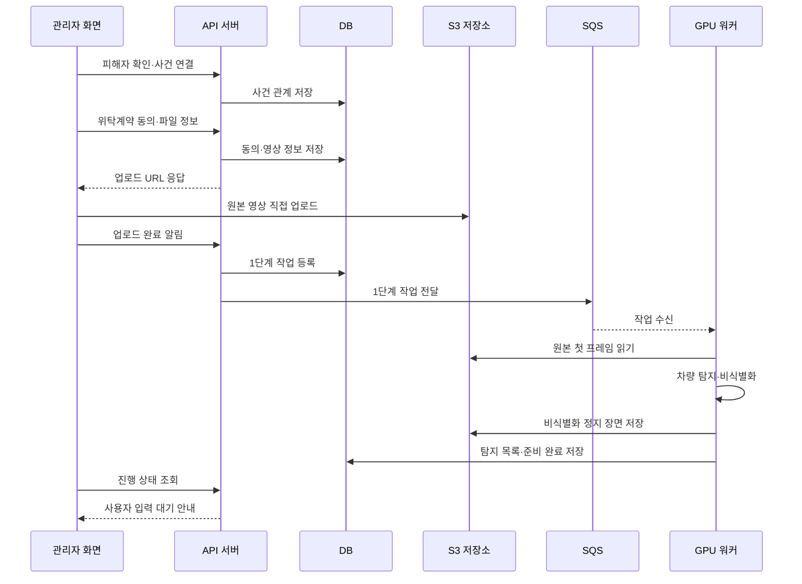
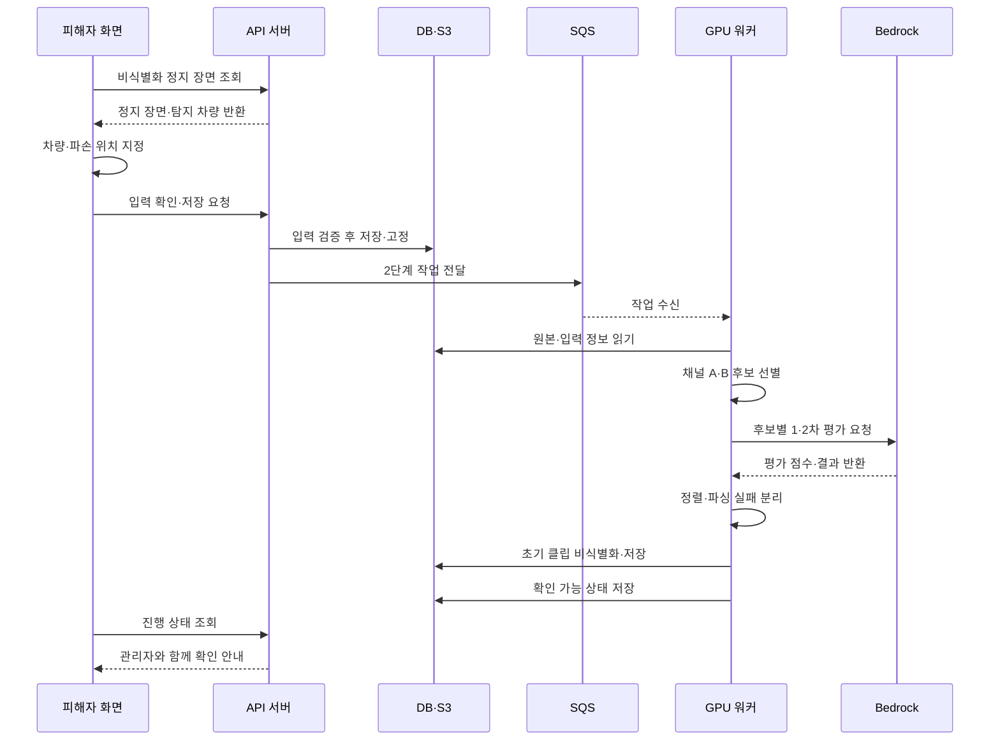
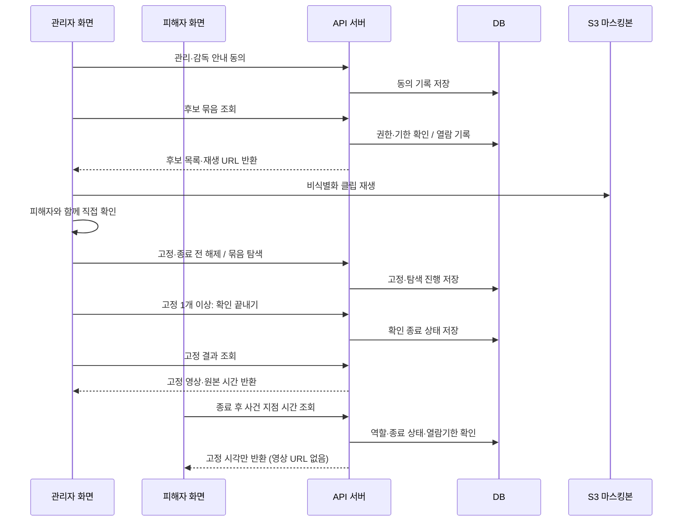

# 소프트웨어 요구사항 명세서 (SRS)

> **D-245·D-246(2026-11-12, 팀장): 후보는 원본 기준 구간(시작·끝)을 가진다. 후보 클립은 움직임이 있던 시간대에 앞뒤 여유 5초를 붙인 30초 이하 영상이다. "판정 시점 5초 후를 중심으로 전후 15초"라는 규칙은 없앤다 (후보 선별·후보 클립 요구사항, 설계 문서 06장 6.5).**

> **D-213(2026-11-02, 팀장): 법적 리스크 정리. 비식별화 누락 대응은 관리자 감독·검수와 관리자 조치로 하고, 운영 단계에서 PbD 컨설팅·인증과 사전적정성 검토제를 받는다. 해결이 어려우면 관리자만 보는 흐름으로 바꾼다 (PRD 문제정의·3.1·활용 방안, 설계 문서 11장 D-213).**

> **D-204(2026-11-01, 팀장): 시스템 흐름을 관리자 주도로 바꾼다. 관리자·피해자 계정을 나누고, 관리자가 피해자를 초대해 사건을 묶는다. 업로드 링크(`upload_tokens`)는 없앤다. 피해자 계정은 입력과 진행도 확인만 하고, 결과는 관리자 관리·감독 안내창에 동의한 뒤 관리자 계정 화면에서 피해자가 확인한다. 백엔드는 반영됐고 프론트엔드 일부가 남았으며, 고칠 곳은 각 설계 문서의 ⚠️ 확인 필요 표시에 있다.**

> **D-210(2026-11-01, 팀장): 피해자 계정은 확인이 끝난 뒤(`finished`·`exhausted`) 사건 지점의 원본 기준 시간만 볼 수 있다. 재생 URL과 영상은 주지 않고, 열람기한(업로드 완료 30일)까지다. 경찰 신고 때 시간을 전달하기 위해서다.**

> **D-112 반영: 사용자용 [분석 다시 시도]를 제공한다. 정상 원본이 남은 기한 내 서비스 오류만 대상으로 완료 결과를 유지하고 미완료 단계부터 재개한다. 중복 접수·실행과 이전 메시지의 결과 덮어쓰기를 막는다. 상세 API·상태·오류 분류는 04·05장을 따른다(D-173 포함). 사용자 재시도는 최초 분석·자동 재시도를 제외하고 작업당 누적 최대 3회다. 서버가 유효하게 접수한 재시도만 원자적으로 차감하며 중복·거절 요청은 차감하지 않는다. 3회 소진 후 다시 실패하면 재시도 버튼 대신 운영 담당자 문의를 안내한다.**

> **2026-10-08 팀장 결정 — D-110: 고정 0개인 확인 종료 요청은 상태를 바꾸지 않고 거절한다. 기존 작업 미종료 상태에서도 새 영상 업로드·분석 요청 및 기존 작업 재진입을 허용한다. 보류 중에도 분석은 계속 진행하며 분석 정지·재개 API는 두지 않는다. 다중 영상의 처리 대기는 데모에서 허용하며 대기 시간 단축·ASG는 이번 범위 밖이다(D-111).**

> **2026-10-08 팀장 결정 — REQ-010·011 보완(D-109): 후보 클립 생성의 재시도 가능한 오류는 최초 포함 총 3회까지 시도한다. 복구 불가능한 오류 또는 재시도 소진은 열람 불가로 구분한다. 정상 클립은 제공하고, 열람 불가 후보는 `not_found`로 기록하지 않는다. 묶음·완료 응답과 화면에서 실패 수 및 실제 확인 범위를 구분하고 전체 클립 실패도 종료 가능해야 한다. 필드·집계 상세는 04·05장을 따른다.**

> 프로젝트: 마스킹 기반 주차장 CCTV 후보선별 서비스
> 작성일: 2026-10-01 · 마지막 수정: 2026-11-12 · 관리 위치: 로컬 개발 문서
> 기준: 현재 팀6 요구사항명세서의 요구사항 16개, 팀6 최종상세설계서(v1.0), PRD, 설계 문서 및 사용자의 최신 결정.

## 1. 목적과 범위

**개발 배경과 문제 정의(D-220)**: 팀장이 주차 중 물피도주 피해를 겪고 경찰서에 사건을 접수하는 과정에서 불편함과 해결되지 않는 문제를 경험했다. 이 경험을 계기로, 피해자가 사건 해결을 위해 할 수 있는 일을 소프트웨어로 돕고자 본 서비스를 기획했다. 문제 정의는 당시 겪은 불편함과, 경찰의 조사에만 의존하지 않고 피해자가 직접 해결하려면 무엇이 필요한지 알아본 과정에서 출발했다. 사고가 언제 일어났는지 모르는 상황에서는 긴 CCTV에서 관련 장면을 찾아야 하고, 관리자의 관리·감독 아래 피해자가 영상을 직접 확인하려면 다른 사람의 개인정보를 보호하는 절차도 필요했다. 기존 비식별화·영상 검색·관제 서비스의 이용 조건과 한계를 검토한 결과, 사고 시점을 모르는 피해자가 개인정보를 보호하면서 관리자의 관리·감독 아래 관련 장면을 직접 확인하기 어렵다는 문제를 해결 대상으로 삼았다. 구체적인 비교와 기획 근거는 [PRD 1장](PRD.md)을 따른다.

긴 주차장 CCTV에서 사용자가 자신의 차량과 파손 위치를 지정하면, 관련 후보 구간을 선별하고 VLM으로 검토 순서를 정한다. 피해자는 관리자의 관리·감독 아래 비식별화된 후보를 직접 확인하고 사건 지점을 고정하여 원본 영상의 시간 위치를 확인한다. AI가 사고 여부나 책임을 확정하는 서비스는 아니다.

학교 프로젝트의 데모·시연 프로그램을 대상으로 한다. 사전 등록된 관리자·피해자 시연용 계정, 피해자 초대와 사건 묶기, 관리자 계정 업로드, 후보 분석, 관리자 관리·감독 아래 열람·고정 및 기간 내 재열람을 제공한다. 일반 회원가입, 실운영 인증 체계, 원본 영상 재생·다운로드, 자동 책임 판정은 범위에 포함하지 않는다. 데모는 HTTP만 사용하며 HTTPS·도메인, 분석 완료 브라우저 알림은 운영 확장으로 둔다(D-146). 본인인증은 있다고 가정하고 구현하지 않는다(D-204).

**범위 근거 (D-214)**: 블랙박스 영상은 입력으로 받지 않고, 사고를 직접 학습한 모델 대신 VLM으로 정렬만 하며, 사전 가입 관제형은 넣지 않는다. 이유는 PRD 2장 "현재 구조로 정한 근거"에 있다.

**법적 구조 (D-213)**: 관리자는 피해자의 열람 요청에 비식별 후 제공할 의무가 있고 비용은 피해자가 낸다(KISA 문의 결과). 비식별화 처리도 위탁계약이어야 하므로 관리자의 관리·감독 아래 진행한다. 그래서 결과 영상은 피해자 계정에서 볼 수 없고 관리자 계정으로만 열리며, 피해자는 관리자 계정 화면에서 관리자 앞에서 확인한다. 비식별화 누락이 보이면 관리자가 조치한다(예: 화면의 해당 부분을 가리고 보여준다). 이 조치는 관리자의 운영 방식이고 시스템 기능이 아니다. 운영 단계에서는 PbD 컨설팅·인증과 사전적정성 검토제를 받으며, 법적 해결이 어렵다고 판단되면 사용자를 관리자만 보는 흐름으로 바꾼다. 핵심 엔진과 파이프라인은 같아서 아파트 입·출차 파손 알림, 물류창고 설비 파손 추적, 수사기관용으로도 활용할 수 있다(PRD 활용 방안). 데모는 PbD 인증과 사전적정성 검토제를 받지 않는다.

기존 서비스 비교·관련 배경은 [PRD 1장](PRD.md)을 참조한다. PRD는 목적·범위, 본 SRS는 요구사항·완료 조건, 설계 문서는 구현 계약을 관리한다.

## 2. 서비스 구조

### 2.1 사용자별 기능 구성

| 사용자 | 기능 영역 | 하위 기능 |
|---|---|---|
| 관리자·피해자 | 회원 | 시연 계정 로그인, 로그아웃, 세션 확인 |
| 관리자·피해자 | 서비스 | 영상 목록, 진행도(업로드 중 / 사용자 입력 중 / 영상분석 중 / 완료)·열람기한 확인 |
| 피해자 | 영상분석 | 정지 장면 확인, 차량 선택, 파손 가시성·위치·바닥 네 모서리·차량 정면 쪽 변·파손 변 입력, 선택 사진·설명 입력, 분석 요청 |
| 관리자 | 사건·영상 제공 | 피해자 초대와 사건 묶기, 위탁계약 동의, 파일 선택·업로드, 선택 녹화 시작 시각 입력 |
| 관리자 | 분석 재시도 | 서비스 오류로 멈춘 분석 다시 시도(작업당 최대 3회) |
| 관리자(피해자가 관리·감독 아래 확인) | 열람 | 관리·감독 안내창 동의, 후보 탐색, 사건 고정·종료 전 해제, 확인 종료, 결과 재열람 |
| 피해자 | 결과 | 확인이 끝난 뒤 사건 지점 시간(원본 기준·추정 실제 시각) 확인 |

### 2.2 시스템 구성과 역할

| 구성 요소 | 역할 | 연결 대상 |
|---|---|---|
| Flutter 웹 | 관리자·피해자 계정 화면, 입력 좌표 변환, 파일 직접 전송, 마스킹 영상 재생 | FastAPI, S3 |
| FastAPI 서버 | 세션·역할·사건 소속 확인, 사건·초대, 업로드 URL 발급, 상태·후보·고정 API | PostgreSQL, S3, SQS |
| PostgreSQL | 계정(역할)·세션·사건·업로드·위탁계약 동의 기록·열람 동의 기록·분석 상태·입력 좌표·후보·고정·접근 기록 | API, GPU 워커 |
| SQS | 비동기 분석 작업 전달 | API, GPU 워커 |
| GPU 워커 | 정지 장면·차량 탐지, 후보 선별, VLM 요청, 비식별화·클립 생성 | S3, PostgreSQL, Bedrock |
| Bedrock VLM | 후보별 관련성 점수 산정과 검토 순서 결정 | GPU 워커 |
| S3 원본 버킷 | 원본 영상·선택 파손 사진 저장, 분석 입력 제공 | 업로드 클라이언트, GPU 워커 |
| S3 마스킹 버킷 | 비식별화 정지 장면·후보 클립 저장 및 제한된 열람 | GPU 워커, 클라이언트 |
| S3 분석 결과 버킷 | 2단계 트랙 결과 파일·추적기 상태 저장. 사용자에게 URL을 발급하지 않는다 | GPU 워커 |

S3는 비공개 버킷 3개(원본·마스킹·분석 결과)로 나눈다. 원본은 분석에 사용하고 사용자 열람은 마스킹본으로 제공한다. 파손 사진은 기존 원본 버킷의 별도 객체이며 새로운 버킷은 만들지 않는다. 상세 연결과 권한은 [아키텍처](design/02-architecture.md)를 따른다.

### 2.3 서비스 이용 흐름

관리자 계정 접속 → 피해자 계정 초대(사건 묶기) → 관리자 위탁계약 동의 → 관리자 영상 업로드 → 비식별화 정지 장면·탐지 차량 제공 → 피해자 계정 차량·파손 입력 → 후보 선별 및 필수 VLM 정렬(진행도는 두 계정에 표시) → 관리자 계정 열람 시도와 관리·감독 안내창 동의 → 관리자 계정 화면에서 피해자가 비식별화 후보 확인 → 필요한 사건 지점 다중 고정 → 확인 종료 및 원본 시간 위치 조회. 결과는 업로드 완료 후 30일의 열람기한 안에서 다시 확인한다. 확인이 끝나면 피해자 계정에서도 같은 기한 안에서 사건 지점 시간을 볼 수 있다(D-210).

## 3. 요구사항 목록

| ID | 요구사항명 | 분류 | 우선순위 |
|---|---|---|---|
| REQ-001 | 시연용 계정 접속 및 로그아웃 | 회원 | 필수 |
| REQ-002 | 피해자 초대 및 사건 연결 | 서비스 | 필수 |
| REQ-003 | CCTV 업로드 및 파일 검증 | 서비스 | 필수 |
| REQ-004 | 차량 선택용 정지 장면 제공 | 영상분석 | 필수 |
| REQ-005 | 차량 및 파손 정보 입력 | 서비스 | 필수 |
| REQ-006 | 좌표 기반 후보 구간 선별 | 영상 분석 | 필수 |
| REQ-007 | VLM 기반 후보 우선순위 정렬 | 영상분석 | 필수 |
| REQ-008 | 열람 장면 비식별화 | 영상분석 | 필수 |
| REQ-009 | 영상 목록 및 분석 상태 조회 | 서비스 | 필수 |
| REQ-010 | 후보 클립 제공 및 사전 준비 | 영상분석 | 필수 |
| REQ-011 | 추가 후보 탐색 및 확인 완료 | 서비스 | 필수 |
| REQ-012 | 사건 지점 다중 고정 | 서비스 | 필수 |
| REQ-013 | 확인 종료 및 결과 재열람 | 서비스 | 필수 |
| REQ-014 | 원본 영상 시간 위치 연결 | 서비스 | 필수 |
| REQ-015 | 보관 기간 및 자료 파기 | 서비스 | 필수 |
| REQ-016 | 접근 권한 분리 및 기록 | 서비스 | 필수 |

## 4. 상세 요구사항

### REQ-001 시연용 계정 접속 및 로그아웃

| 항목 | 명세 |
|---|---|
| 요구사항분류(대상) | 회원 |
| 우선순위 | 필수 |
| 관련화면 | 로그인, 영상 목록 |
| 관련API·DB | POST /api/auth/login, POST /api/auth/logout GET /api/auth/me; DB: users, sessions |
| 기능설명 | 사용자는 사전 등록된 관리자 또는 피해자 시연 계정으로 접속하고, 세션 유효 기간 안에서 사건의 영상과 진행 상태를 이어서 조회할 수 있어야 한다. 계정의 역할에 따라 쓸 수 있는 기능이 나뉜다(D-204). |
| 입력항목 | 시연용 아이디·비밀번호(문자열, 필수). 운영자가 시연 전에 역할을 지정해 계정을 등록하며 일반 회원가입은 제공하지 않는다. |
| 처리조건 | 비밀번호를 해시와 대조하고 DB 세션을 발급한다. 세션은 7일간 유효하며, 로그아웃 시 해당 세션과 쿠키를 삭제한다. |
| 완료조건 | 정상 계정으로 영상 목록에 진입하며, 로그아웃 후 보호된 화면 접근 시 로그인을 요청한다. |
| 예외처리 | 실패 원인을 아이디·비밀번호로 구분해 노출하지 않고 로그인 실패만 안내한다. 세션 만료 시 재로그인을 안내하며 비밀번호와 평문 토큰은 응답·로그에 남기지 않는다. |

### REQ-002 피해자 초대 및 사건 연결

| 항목 | 명세 |
|---|---|
| 요구사항분류(대상) | 서비스 |
| 우선순위 | 필수 |
| 관련화면 | 피해자 초대, 영상 목록 |
| 관련API·DB | 피해자 확인·사건 생성·초대 API, 사건 목록 API(05장 24·21·22번) DB: users, cases |
| 기능설명 | 관리자는 관리자 계정으로 피해자 계정을 초대해 사건 하나로 묶을 수 있어야 한다(D-204). |
| 입력항목 | 초대할 피해자 계정의 아이디(필수). |
| 처리조건 | 관리자 계정만 초대할 수 있다. 관리자는 아이디와 가린 이름으로 대상을 확인한 뒤 연결한다(D-206). 수락 단계 없이 초대하면 바로 묶인다. 사건 하나에는 관리자 계정 1개와 피해자 계정 1개가 묶인다. 초대를 기록한다. |
| 완료조건 | 두 계정의 목록에 같은 사건이 나타나고, 사건의 영상을 역할에 맞게 다룰 수 있다. |
| 예외처리 | 없는 계정이나 피해자 역할이 아닌 계정을 초대하면 안내한다. 피해자 계정의 초대 요청은 거절한다. |

### REQ-003 CCTV 업로드 및 파일 검증

| 항목 | 명세 |
|---|---|
| 요구사항분류(대상) | 서비스 |
| 우선순위 | 필수 |
| 관련화면 | 영상 업로드, 영상 목록 |
| 관련API·DB | 사건 기준 업로드 presign·complete API(05장 6·7번), GPU 켜기 요청 API(16번) DB: videos, analysis_jobs, upload_agreements; 저장소: S3. 위탁계약 동의는 presign 요청에 함께 보내 저장한다(D-147, D-204) |
| 기능설명 | 관리자는 관리자 계정으로 사건을 골라 개인정보 처리위탁 계약에 동의한 뒤 CCTV 파일을 직접 업로드하고 진행률과 완료 여부를 확인할 수 있어야 한다. |
| 입력항목 | 위탁계약 동의: 확인 체크 3개(필수). 입력칸은 없고, 본인인증은 있다고 가정한다. 손서명은 받지 않는다(D-147, D-204). 영상 1개 MP4·AVI·MKV·MOV, H.264·H.265. 영상 첫 장면의 녹화 시작 시각은 선택 입력한다. 시연 프로그램은 파일 1개 최대 5GB로 제한한다. 운영 전환 시 브라우저 분할 전송을 적용한다(부록 A, 제출 보고서에서는 제외). |
| 처리조건 | 동의 기록(체크 항목, 계약 문구 버전, 동의 시각, 접속 IP)을 관리자 계정과 사건에 연결해 저장하고 동의한 때부터 90일 보관한다. 동의 기록이 없으면 업로드 URL을 발급하지 않는다. 크기·확장자를 검사한다. S3 직접 업로드의 완료를 확인한 뒤 1단계 작업을 등록하고 코덱을 검사한다. |
| 완료조건 | 업로드 파일이 사건에 연결되고, 두 계정의 영상 목록에 등록되어 정지 장면 준비를 시작한다. |
| 예외처리 | 피해자 계정의 업로드 요청은 거절한다. 크기·형식 초과는 전송 전에 안내한다. 읽을 수 없는 코덱은 관리자 재업로드를 안내하며, 업로드 미확인은 진행 중과 구분해 안내한다. |

### REQ-004 차량 선택용 정지 장면 제공

| 항목 | 명세 |
|---|---|
| 요구사항분류(대상) | 영상분석 |
| 우선순위 | 필수 |
| 관련화면 | 차량 선택 및 파손 부위 입력 |
| 관련API·DB | GET /api/videos/{video_id}/still DB: still_frames; 실행: GPU 워커 |
| 기능설명 | 피해자는 피해자 계정에서 원본 영상의 첫 프레임을 비식별화한 정지 장면으로 본인 차량을 확인할 수 있어야 한다. |
| 입력항목 | 업로드가 완료된 CCTV 영상과 해당 영상 식별자(필수). |
| 처리조건 | 1단계에서 첫 프레임을 추출하고 차량을 탐지한다. 전체 장면의 번호판·얼굴을 비식별화한다. 평소에는 차량 표시를 하지 않고, 사용자가 차를 누르면 그 차 전체를 칠한다. |
| 완료조건 | 작업당 정지 장면 1장과 탐지 차량 목록을 제공하고, 비식별화 완료 후 사용자 입력 화면을 연다. |
| 예외처리 | 본인 차량이 없거나 가려져 선택할 수 없으면 관리자에게 차량이 보이는 시작 구간으로 재업로드를 요청하도록 안내한다. |

### REQ-005 차량 및 파손 정보 입력

| 항목 | 명세 |
|---|---|
| 요구사항분류(대상) | 서비스 |
| 우선순위 | 필수 |
| 관련화면 | 차량 선택 및 파손 부위 입력, 저장 확인창 |
| 관련API·DB | PUT /api/videos/{video_id}/input POST /api/videos/{video_id}/input/photo DB: vehicle_selections, damage_inputs |
| 기능설명 | 피해자는 피해자 계정에서 본인 차량과 파손 부위의 가시성·위치를 지정하고 분석을 요청할 수 있어야 한다. |
| 입력항목 | 차량·가시성·위치·내 차 바닥 네 모서리·차량 정면 쪽 변(D-194)·파손 변(필수). 사진 1장(선택, 20MB 이하, JPG/JPEG/PNG/HEIC), 설명(선택, 500자 이하). |
| 처리조건 | 보임이면 선택한 차량 안에서 실제 파손 부위를 드래그한다. 안 보임이면 CCTV에 보이지 않더라도 파손 부위가 있는 위치를 선택한 차량 안에서 작은 사각형으로 드래그한다. 두 경우 모두 원본 화면 절대 픽셀 좌표로 저장한다. 이어서 내 차가 바닥에 닿는 네 모서리를 찍고(보이지 않는 모서리는 짐작), 네 변 중 파손이 있는 변(한 변, 모서리 파손이면 이웃한 두 변)을 고른다. 저장 확인 후 입력을 고정하고 분석을 요청한다. |
| 완료조건 | 필수 입력·좌표를 검증하여 한 번 저장한다. 사진·설명은 선택이며 VLM 정렬에 활용한다. 보임·안 보임 모두 위치 사각형이 필수이며 원본 화면 범위를 검증한다. 안 보임 좌표는 보이는 파손 표면의 관측값으로 취급하지 않는다. |
| 예외처리 | 관리자 계정의 입력 요청은 거절한다. 차량·좌표·첨부 자료 오류를 안내한다. 저장 후 수정 요청은 거부하고 현재 상태를 표시한다. |

### REQ-006 좌표 기반 후보 구간 선별

| 항목 | 명세 |
|---|---|
| 요구사항분류(대상) | 영상 분석 |
| 우선순위 | 필수 |
| 관련화면 | 분석 진행, 후보 확인 |
| 관련API·DB | 입력 저장 후 SQS 작업 실행 DB: candidates; 실행: GPU 워커 |
| 기능설명 | 시스템은 차량·파손 위치 주변의 접근 장면을 선별하여 사용자가 확인할 후보를 구성하여야 한다. |
| 입력항목 | 원본 영상, 차량 영역, 파손 가시성 및 파손 쪽 위치, 내 차 바닥 네 모서리와 파손 변(필수). |
| 처리조건 | 본인 차량 주변을 잘라낸 분석 영역에서 움직임 감지(MOG2)를 영상 전체에 돌리고, 근접 영역(ROI)에 움직임이 있는 구간(앞뒤 여유 포함)에만 객체탐지·추적(YOLO·ByteTrack)을 돌린다. 배경이 안정되기 전에는 객체탐지를 계속 실행한다. 근접 영역의 크기는 내 차 바닥 네 모서리로 파악한 CCTV 시야와 거리로 정한다(D-202). ROI에 닿은 트랙을 후보로 삼고, 보이는 파손 부위의 근접 장면 및 가려진 쪽 인접 공간의 진입·이탈을 수집한다. 바닥점·가림 변화는 차 앞·차 너머 등 명백히 무관한 통행을 제외하는 데만 쓰며, 차 앞 트랙은 차 영역 아래쪽 1/2로 판단한다(D-219). |
| 완료조건 | 후보별 원본 기준 구간(시작·끝)과 위치를 저장한다. 누락 최소화를 우선하며 불확실한 접촉 가능성도 후보에 유지한다. |
| 예외처리 | 후보가 0개이면 해당 사실을 표시한다. 가림만으로 관련 장면을 제외하거나 후보 부재를 사건 부재로 판정하지 않는다. |

### REQ-007 VLM 기반 후보 우선순위 정렬

| 항목 | 명세 |
|---|---|
| 요구사항분류(대상) | 영상분석 |
| 우선순위 | 필수 |
| 관련화면 | 후보 확인 |
| 관련API·DB | GPU 워커 → AWS Bedrock DB: candidates |
| 기능설명 | 시스템은 접촉 가능성이 높은 후보를 먼저 확인하도록 원본 후보 장면을 평가해 순서를 정하여야 한다. VLM 정렬은 필수 기능이며 사진·설명 없이도 수행한다. |
| 입력항목 | 후보 프레임, 차량·파손 위치 및 안내 프레임(필수). 파손 사진·설명은 입력된 경우 함께 사용한다. |
| 처리조건 | 1차에서 관련성이 명확히 낮은 후보는 0점으로 두고, 나머지는 2차에서 각각 0~100점을 부여한 후 점수순으로 정렬한다. |
| 완료조건 | 정렬 전후 후보 수(점수 목록과 파싱 실패 목록의 합)가 같고 0점 후보도 목록에 남는다. 화면에는 후보 영상과 순서, 후보별 VLM 점수를 제공하며 접촉 판정 결과는 표시하지 않는다. |
| 예외처리 | 가려져 보이지 않는 사실만으로 접촉 여부를 단정하지 않는다. 점수 형식 오류는 최대 3회 호출하고, 끝내 실패하면 1차는 통과시키고 2차는 0점 대신 파싱 실패 목록으로 보내 시간순으로 남긴다(D-177). 1차·2차 각각 형식 실패가 30%를 넘으면 분석 실패로 처리한다. 일시적 호출 오류는 대기 후 재시도하고, 총 약 10분을 넘기면 분석 실패로 처리한다. |

### REQ-008 열람 장면 비식별화

| 항목 | 명세 |
|---|---|
| 요구사항분류(대상) | 영상분석 |
| 우선순위 | 필수 |
| 관련화면 | 정지 장면, 후보 확인, 고정 결과 |
| 관련API·DB | 정지 장면·묶음·고정 결과 조회 API 저장소: 원본·마스킹본 영역 분리 |
| 기능설명 | 사용자에게 제공하는 정지 장면과 후보 영상은 비식별화가 끝난 결과만 표시하여야 한다. |
| 입력항목 | 차량 선택용 정지 장면 또는 제공할 후보 구간(필수). |
| 처리조건 | 번호판과 사람 얼굴을 모자이크한다. 얼굴이 안정적으로 탐지되지 않은 사람은 모든 프레임에서 해당 트랙 전체를 가리고, 후보 영상은 본인 차량 주변을 16:9로 잘라 제공한다. |
| 완료조건 | 선택 화면은 전체 장면, 후보·고정 화면은 차량 주변 마스킹본만 보여준다. 후보 선별과 VLM 분석에는 원본을 사용한다. |
| 예외처리 | 비식별화가 완료되지 않은 장면은 제공하지 않는다. 재접속·이전 묶음·고정 클립 재생에도 동일한 열람 기준을 적용한다. 모자이크 누락을 시스템이 막지는 못하므로, 누락이 보이면 관리자가 열람 중에 조치한다(운영 방식, D-213). 이 때문에 마스킹본은 피해자 계정에 열지 않고 관리자 계정에서만 연다. |

### REQ-009 영상 목록 및 분석 상태 조회

| 항목 | 명세 |
|---|---|
| 요구사항분류(대상) | 서비스 |
| 우선순위 | 필수 |
| 관련화면 | 영상 목록, 대기 및 분석 진행 |
| 관련API·DB | GET /api/videos, GET /api/videos/{video_id} DB: videos, analysis_jobs |
| 기능설명 | 관리자·피해자 계정은 사건의 영상 목록과 진행도를 확인할 수 있어야 한다. 진행도는 러프하게 업로드 중 / 사용자 입력 중 / 영상분석 중 / 완료 4단계다(D-204). |
| 입력항목 | 로그인 세션, 조회할 영상 식별자(선택). |
| 처리조건 | DB 상태를 주기적으로 조회해 상세 상태를 4단계 진행도로 묶어 두 계정에 표시한다. 피해자 계정 응답에는 후보·결과 정보를 넣지 않는다. 관리자 계정에는 대기 시 앞선 작업 수를 제공한다. |
| 완료조건 | 화면을 닫았다 다시 접속해도 작업과 결과가 유지된다. 입력 완료 여부와 보관 만료 여부에 맞는 화면을 표시한다. 목록·후보·결과 화면에 API가 제공하는 열람기한을 표시한다. 업로드 완료 전에는 날짜 대신 기한 산정 전임을 안내한다. |
| 예외처리 | 영상 자체가 잘못된 경우(읽을 수 없는 코덱, 길이 0, 원본 없음)만 즉시 분석 실패로 처리한다. 분석 서버가 중간에 멈추면 같은 작업을 이어서 하고, 같은 작업이 3번 멈추면 분석 실패로 처리한다. 분석 실패 시 실패 상태와 후속 조치를 안내한다. 원본 문제는 관리자가 파일을 확인한 뒤 같은 사건에 다시 올리도록 안내한다. 서비스 오류는 `can_retry`·`retry_left`에 따라 관리자에게 작업당 최대 3회 [분석 다시 시도] 또는 횟수 소진 안내(운영 담당자 문의)를 제공한다. 완료된 결과는 보존하고 중복·거절 요청은 횟수에서 빼지 않는다(D-112, D-173). 내부 오류 상세는 노출하지 않는다. 업로드 미확인·열람기한 만료는 분석 실패와 구분한다. |

### REQ-010 후보 클립 제공 및 사전 준비

| 항목 | 명세 |
|---|---|
| 요구사항분류(대상) | 영상분석 |
| 우선순위 | 필수 |
| 관련화면 | 관리·감독 안내창, 후보 확인 |
| 관련API·DB | 열람 동의 API(05장 23번), GET /api/videos/{video_id}/batch DB: viewing_agreements, candidate_clips; 실행: GPU 워커 |
| 기능설명 | 피해자는 관리자 관리·감독 아래 관리자 계정 화면에서 정렬된 후보를 최대 10개씩, 본인 차량 주변의 비식별화된 영상으로 재생할 수 있어야 한다. |
| 입력항목 | 정렬된 후보 목록, 원본 영상, 차량 영역(필수). |
| 처리조건 | 관리자 계정으로 열람을 시도할 때마다 관리·감독 주의 안내창을 띄우고, 체크로 동의하면 기록을 1행 남긴다. 서버는 해당 영상에 30분 안에 남긴 동의 기록이 있어야 열람을 허용한다(D-205). 열람 중 비식별화 누락이 보이면 관리자가 그 자리에서 조치한다(시스템 기능 없음, D-213). 움직임이 있던 시간대(후보 구간)에 앞뒤 여유 5초를 붙여 최대 30초 클립을 만든다(설계 문서 06장 6.5). 처음에는 상위 20개를 준비하고 이후 한 묶음 앞서 준비한다. 파싱 실패 목록도 같은 방식으로 따로 준비하고, 화면에서는 별도 탭으로 제공한다. |
| 완료조건 | 한 묶음은 최대 10개·5분 분량이다. 10개 묶음의 비식별화를 5분 이내에 완료하며 후보가 적으면 있는 수만 제공한다. |
| 예외처리 | 안내창에 동의하지 않으면 열람할 수 없다. 피해자 계정의 열람 요청은 거절한다. 영상 시작·끝을 넘는 부분은 제외한다. 클립 생성은 재시도 가능한 오류에 한해 최초 포함 최대 3회 시도하며, 복구 불가능한 오류나 재시도 소진은 열람 불가로 표시하고 정상 클립은 계속 제공한다(D-109). 다음 묶음이 준비 중이면 대기를 알리고 이미 받은 후보는 계속 확인할 수 있게 한다. |

### REQ-011 추가 후보 탐색 및 확인 완료

| 항목 | 명세 |
|---|---|
| 요구사항분류(대상) | 서비스 |
| 우선순위 | 필수 |
| 관련화면 | 후보 확인, 후보 전부 확인 완료 |
| 관련API·DB | GET /api/videos/{video_id}/batch?batch_no=N POST /api/videos/{video_id}/batch/next DB: analysis_jobs, candidates |
| 기능설명 | 관리자 계정 화면에서 피해자는 다음 후보 묶음을 요청하거나 이미 받은 묶음으로 돌아가 영상을 확인할 수 있어야 한다. |
| 입력항목 | 현재 묶음 번호와 이전·다음 요청(필수). |
| 처리조건 | 점수 목록과 파싱 실패 목록을 따로 탐색한다. 다음 요청 시 아직 제공하지 않은 상위 후보 10개를 전달하며, 현재 묶음의 열람 가능한 미고정 후보를 못 찾음으로 처리한다. 고정 후보는 유지하고 열람 불가 후보는 못 찾음에 포함하지 않는다(D-109). 이전 묶음 조회는 확인 진행을 되돌리지 않으며 종료 전에는 고정도 가능하다. |
| 완료조건 | 두 목록의 마지막 묶음까지 넘기면 후보 전부 확인 완료를 표시한다. 후보가 처음부터 0개인 경우는 후보 구간 미탐지로, 열람 불가가 있는 경우는 전부·일부 열람 불가로 구분하고 실제 확인 범위를 표시한다. |
| 예외처리 | 마지막 다음 요청 전 확인창을 띄운다. 모든 클립이 열람 불가여도 기존 [다음 묶음 받기]로 종료할 수 있다(D-203). 완료 후에는 새 고정·해제를 받지 않으며, 완료 문구를 사건이 없다는 의미로 사용하지 않는다. |

### REQ-012 사건 지점 다중 고정

| 항목 | 명세 |
|---|---|
| 요구사항분류(대상) | 서비스 |
| 우선순위 | 필수 |
| 관련화면 | 후보 확인, 고정 확인창, 결과 목록 |
| 관련API·DB | POST /api/videos/{video_id}/pin, DELETE /api/videos/{video_id}/pin/{candidate_clip_id} DB: pinned_incidents, candidate_clips |
| 기능설명 | 관리자 계정 화면에서 피해자는 의심 장면에서 찾음을 선택해 해당 후보를 사건 지점으로 고정하고, 확인 종료 전에는 고정을 해제할 수 있어야 한다(D-181). |
| 입력항목 | 사용자에게 제공된 후보 클립 식별자(필수). |
| 처리조건 | 확인창 후 고정 정보를 저장한다. 한 영상에서 여러 후보를 고정할 수 있으며, 고정해도 후보 확인 화면과 탐색을 유지한다. 고정 해제는 `ready`·`batch_running` 상태에서만 할 수 있다. |
| 완료조건 | 고정 상태와 결과 목록을 동기화한다. 다음 묶음 준비 중에도 이전에 받은 정상 후보를 고정·해제할 수 있다. |
| 예외처리 | 같은 후보의 반복 고정은 중복 저장하지 않는다. 고정되지 않은 클립의 해제는 그대로 성공으로 처리한다. 다른 사건·미제공·열람 불가 후보, 확인 종료 후 고정·해제 요청은 거부한다. |

### REQ-013 확인 종료 및 결과 재열람

| 항목 | 명세 |
|---|---|
| 요구사항분류(대상) | 서비스 |
| 우선순위 | 필수 |
| 관련화면 | 후보 확인, 확인 종료창, 결과 목록 |
| 관련API·DB | POST /api/videos/{video_id}/finish GET /api/videos/{video_id}/pin |
| 기능설명 | 관리자 계정 화면에서 피해자는 원하는 장면을 고른 뒤 확인을 끝내고 고정한 사건 지점 목록을 다시 조회할 수 있어야 한다. |
| 입력항목 | 고정된 사건 지점 1개 이상과 확인 종료 요청(필수). |
| 처리조건 | 고정이 있을 때 확인 끝내기를 제공하고 종료 전 확인창을 띄운다. 종료 후 고정 목록과 원본 시간 정보를 표시한다. |
| 완료조건 | 재접속 후에도 보관 기간 안에서 고정한 마스킹 클립을 재생할 수 있다. 전체 후보를 확인한 경우에도 기존 고정 목록을 제공한다. 결과의 열람기한은 업로드 완료 시각 + 30일이며 한국 시간으로 표시한다. 확인 종료나 사건 고정으로 연장하지 않는다. |
| 예외처리 | 고정이 없으면 종료 버튼을 제공하지 않고 서버도 고정 0개의 종료 요청을 상태 변경 없이 거절한다(D-110). 종료 후 고정·해제는 받지 않으며 영상 다운로드 기능은 제공하지 않는다. 고정 해제와 종료가 동시에 요청되면 같은 작업 잠금으로 순서를 정한다. |

### REQ-014 원본 영상 시간 위치 연결

| 항목 | 명세 |
|---|---|
| 요구사항분류(대상) | 서비스 |
| 우선순위 | 필수 |
| 관련화면 | 고정 결과 목록 및 클립 재생, 피해자 사건 시간 화면 |
| 관련API·DB | GET /api/videos/{video_id}/pin, GET /api/videos/{video_id}/incident-times DB: videos, candidates, candidate_clips |
| 기능설명 | 관리자 계정 화면에서 피해자는 고정된 클립이 업로드 원본의 어느 시간 구간인지 확인할 수 있어야 한다. 확인이 끝난 뒤에는 피해자 계정에서도 그 시간 구간을 다시 볼 수 있어야 한다(D-210). |
| 입력항목 | 클립의 원본 기준 시작·끝 경과시간(필수), 녹화 시작 시각(선택). |
| 처리조건 | 디코딩 분할·크롭·인코딩 이후에도 원본 시간 연결을 유지한다. 녹화 시작 시각이 있으면 경과시간을 더해 추정 실제 시각을 계산한다. 피해자 계정에는 작업이 끝 상태일 때만 시간 구간을 주고, 재생 URL은 주지 않는다. |
| 완료조건 | 각 고정 클립에 원본의 시작~끝 경과시간을 표시하고, 녹화 시작 시각을 입력한 경우 추정 실제 시각을 함께 표시한다. |
| 예외처리 | 녹화 시작 시각이 없으면 경과시간만 표시한다. 실제 시각에는 추정 표시를 붙이고 경과시간을 항상 함께 제공한다. 확인이 끝나기 전에는 피해자 계정에 빈 목록을 준다. 열람기한이 지나면 피해자 계정에도 만료를 안내한다. |

### REQ-015 보관 기간 및 자료 파기

| 항목 | 명세 |
|---|---|
| 요구사항분류(대상) | 서비스 |
| 우선순위 | 필수 |
| 관련화면 | 영상 목록, 결과, 보관 기간 종료 안내 |
| 관련API·DB | S3 수명 주기 규칙, 백엔드 파기 표시·기록 작업 및 영상 조회 API DB: videos; 저장소: 원본·분석 결과·마스킹본 (D-136, D-142) |
| 기능설명 | 시스템은 영상별 열람 가능 기한을 안내하고 보관 기간이 지난 자료를 정리하여야 한다. |
| 입력항목 | 업로드 완료 시각, 영상별 저장 자료와 파기 상태(필수). |
| 처리조건 | 업로드 완료 기준 30일이 되면 분석·확인 상태와 관계없이 원본, 파손 사진, 분석 결과 및 모든 정지 장면·후보 마스킹본을 파기 대상으로 처리한다. 실제 삭제는 객체 생성 기준 S3 수명 주기 규칙을 기본으로 하며, DB 표시·기록 시각과 실제 삭제 시각은 다를 수 있다(D-136, D-142). |
| 완료조건 | 고정 여부와 무관하게 동일한 기한을 적용한다. 보관 종료 후 열람용 URL 발급과 추가 분석을 차단하고 삭제 안내를 표시한다. |
| 예외처리 | 보관 만료는 분석 실패와 구분한다. 종료된 작업도 기한까지 열람할 수 있으며, 고정 시 보관 기간을 연장하지 않는다. 동의·접근 기록은 영상과 별도의 보관 정책을 따른다(위탁계약 90일, 열람 동의·접근 기록은 삭제하지 않음). |

### REQ-016 접근 권한 분리 및 기록

| 항목 | 명세 |
|---|---|
| 요구사항분류(대상) | 서비스 |
| 우선순위 | 필수 |
| 관련화면 | 전체 보호 화면 |
| 관련API·DB | 영상 관련 API 공통 인증·역할·사건 소속 검사 DB: users, sessions, cases, viewing_agreements, access_logs; IAM |
| 기능설명 | 시스템은 관리자 계정과 피해자 계정의 권한을 분리하고 영상 접근을 사건 단위로 통제하여야 한다. |
| 입력항목 | 세션, 요청 대상 영상과 행위(필수). |
| 처리조건 | 매 요청에 역할과 사건 소속을 확인한다. 후보·고정·결과 API는 관리자 계정만, 입력 API는 피해자 계정만 쓴다. 사건 지점 시간 조회 API는 두 계정 모두 쓰고, 안내 동의를 요구하지 않는다. 열람 API는 30분 안에 남긴 관리·감독 안내 동의 기록이 있어야 한다. S3를 비공개로 두고 마스킹본에만 기본 15분과 남은 열람 기간 중 짧은 시간 동안 유효한 재생 URL을 발급한다. 로그인·초대·열람·고정 등 주요 행위를 기록한다. 열람 기록의 행위자는 관리자 계정이다. |
| 완료조건 | 다른 사건의 자료와 원본 재생 정보가 응답에 노출되지 않는다. 피해자 계정 응답에 후보 클립과 재생 URL이 나오지 않는다. 사건 지점 시간은 확인이 끝난 뒤에만 나온다. 비밀번호·평문 토큰은 DB와 로그에 저장하지 않는다. |
| 예외처리 | 미인증 요청은 로그인을 안내하고 다른 사건의 영상은 조회를 거부한다. 재생 URL 만료 시 권한 재검사 후 새 URL로 재생을 이어간다. |

## 5. 인터페이스와 데이터 요구사항

### 5.1 파손 위치 입력

`PUT /api/videos/{video_id}/input`은 `schema_version: 6`, 차량 `det_id`, `damage.visible`, `damage.damage_bbox`를 필수로 받는다. 위치는 `[x1, y1, x2, y2]` 정수 배열이며 원본 화면 좌표로 저장한다. 두 경우 모두 `0 <= x1 < x2 <= width`, `0 <= y1 < y2 <= height`를 만족해야 한다. 보임·안 보임 모두 선택 차량 박스 내부로 한정한다. 안 보임은 파손 부위가 있는 위치의 작은 사각형이다. 작은 사각형의 고정 픽셀 크기를 강제하지 않는다. 브라우저 표시 배율과 여백은 좌표 변환 때 제거한다. 내 차 바닥 네 모서리(원본 화면 좌표 점 4개), 차 앞쪽 변(1개), 파손 변(1개 또는 이웃한 2개)도 필수로 함께 받는다. 키 이름은 `floor_corners`(점 4개), `front_edge`(변 번호 0~3), `damage_edges`(변 번호 1~2개)다 (D-98, D-99, D-194, D-208).

안 보임 예시:

```json
{
  "still_frame_id": 305,
  "schema_version": 6,
  "vehicle": {"det_id": 1},
  "damage": {
    "visible": false,
    "damage_bbox": [805, 510, 825, 530],
    "floor_corners": [[700, 640], [1010, 650], [960, 520], [760, 515]],
    "front_edge": 2,
    "damage_edges": [2]
  }
}
```

사각형은 사용자 지정 위치다. 워커는 가시성에 따라 해석하고 후보 탐색의 인접 영역과 VLM 안내에 사용한다. 구체적인 근접 임계값은 후보 탐지 모델·룰 설계에서 정한다.

### 5.2 파손 사진 API

1. `POST /api/videos/{video_id}/input/photo`에 `filename`, `size_bytes`를 보낸다. 로그인한 피해자 계정이 그 영상의 사건에 묶여 있고 입력 저장 전 상태인지 확인한다.
2. API가 `upload_url`, `photo_key`를 반환한다. JPG·JPEG·PNG·HEIC, 최대 20MB를 허용한다.
3. 브라우저가 사진 바이트를 해당 URL로 `PUT`한다. 성공 후 차량·파손 입력 저장 요청에 `photo_key`를 함께 보낸다.
4. 저장 위치는 기존 원본 버킷의 `videos/{video_id}/inputs/photo.{ext}`다. 원본 영상과 별도 객체이며 영상과 동일한 보관기한으로 파기한다.

사진은 선택 입력이다. 업로드에 실패하면 재시도하거나 사진 없이 진행한다. 서버 본문에 이미지 바이트나 base64를 넣지 않으며, 원본 사진 열람 API를 추가하지 않는다. 요청·응답·오류는 [API 5.7 및 5.11](design/05-api.md)을 따른다.

### 5.3 열람기한과 실패 표시

영상 목록·상세 API는 `view_expires_at`을 제공한다. `upload_completed_at + 30일`로 계산하며 업로드 완료 전에는 `null`이다. DB에 같은 값을 중복 저장하지 않는다. 후보·고정 결과 화면은 상세 API의 값을 재사용한다. 한국 시간으로 “YYYY-MM-DD HH:mm까지 열람 가능”을 표시한다.

기한이 지나면 새로운 열람 URL과 추가 분석을 차단한다. 파일 삭제 완료 여부와 열람기한은 구분한다. 실패 화면은 실패 상태와 후속 조치를 안내하고 내부 개발자 오류 메시지는 표시하지 않는다.

### 5.4 데이터 관리

엔티티는 users, sessions, cases, videos, analysis_jobs, still_frames, vehicle_selections, damage_inputs, candidates, candidate_clips, pinned_incidents, access_logs, 위탁계약 동의 기록용 `upload_agreements`(D-147), 관리·감독 안내 동의 기록용 viewing_agreements다. `upload_tokens`는 없앤다(D-204). 새 파손 사진 버킷·테이블이나 열람기한 저장 칼럼을 추가하지 않는다. 입력은 JSONB에 버전 6으로 저장한다 (D-99, D-208). 상세 필드·상태 전이·S3 경로는 [데이터 설계](design/04-data-model.md)를 따른다.

## 6. 테스트 및 AI 성능 평가

### 6.1 목표 성능과 KPI 측정

| 평가 항목 | 목표 | 측정 단위와 방법 |
|---|---|---|
| 비식별화 누락률 | 5% 이하 | 평가용 정답 얼굴·번호판 박스 중 최종 마스크가 중심을 가리지 못한 박스 수 / 전체 정답 박스 수 × 100. 얼굴·번호판 합산을 공식 지표로 사용 |
| 사고 클립 후보 검출 누락률 | 1% 이하 | 평가용 충돌 A 클립 중 후보가 하나도 생성되지 않은 클립 수 / 평가용 충돌 A 클립 수 × 100. 클립 전체를 1개 평가 단위로 사용 |
| 필수 VLM 정렬 품질 | ROC AUC 0.80 이상 | 후보 선별을 통과한 충돌 A·비충돌 V·S·W 클립의 최종 점수로 계산. 1차 평가에서 0점으로 남은 후보도 포함 |

- 비식별화는 단일 모델 AP가 아니라 타일·추적·보간·사람 전체 가리기를 포함한 최종 파이프라인 결과로 평가한다. 사람은 AI Hub 「유동 인구 분석을 위한 CCTV 영상 데이터」, 번호판은 AGH 「Parking Database」(주차장 영상·번호판 4점 좌표를 외접 사각형으로 변환, 평가에만 사용, 폴란드 번호판)로 평가한다(D-215). 얼굴 라벨이 없으면 사람 영역 위쪽 머리 영역의 중심이 얼굴 또는 사람 전체 마스크에 가려졌는지로 판정한다. 최종 데이터 구성과 프레임 간격은 측정 전에 확정한다(U-29). 비식별화 누락은 관리자 검수·조치로 보완한다.
- 후보 10개의 비식별화 클립 생성 5분 이내는 목표 성능으로 함께 점검하며, 공식 KPI 3종에는 포함하지 않는다.
- 후보 검출과 VLM은 PRD에 정한 Kaggle Parking Vehicle Hit and Run Dataset을 사용하며, 차량·파손 위치 등 필요한 입력 라벨은 팀이 작성한다.
- 조정용과 최종 평가용 자료를 분리하고 임계값·제외 기준·프롬프트·모델 버전을 평가 전에 고정한다. 학습·조정에 사용한 자료로 최종 KPI를 계산하지 않는다.
- VLM temperature는 0으로 두며 사진·설명이 없는 샘플은 해당 선택 입력을 제외한다. 누락된 입력을 임의 생성하지 않는다.
- 달성 여부는 평가 데이터의 실측값으로 판단한다. 누락 수·전체 수·측정 조건을 함께 기록한다. 단측 95% 신뢰 상한과 AUC 신뢰구간은 표본 불확실성에 관한 보조 정보이며 별도의 합격 기준이 아니다. 상세 계산은 [평가 설계 9.4](design/09-evaluation.md)를 따른다.

### 6.2 사용 흐름 검증

| 검증 대상 | 확인 조건 |
|---|---|
| 입력·좌표 | 보임·안 보임 모두 차량 내부의 사각형을 수용하고 차량 밖·화면 밖·빈 사각형은 거절. 바닥 네 모서리 4개와 파손 변(1개 또는 이웃한 2개)이 없으면 거절 |
| 사진 | 허용 형식·크기, 소유권, 직접 업로드 후 키 저장, 선택 입력 생략 처리 |
| 후보·정렬 | 정렬 전후 후보 수 보존(파싱 실패 목록 포함), 0점 후보 유지, 파싱 실패 시간순 분리, 두 목록 독립 탐색, 비식별화본만 재생 |
| 클립 준비 | 후보 10개의 비식별화를 5분 이내 완료. 원본 시간 연결, 최대 30초·16:9 확인, 생성 재시도·열람 불가 수 구분, 전체 클립 실패 시 종료 가능 |
| 진행·고정 | 새로 접속해도 상태 유지, 다중 고정·중복 요청 처리, 종료 전 고정 해제, 고정 0개 종료 거절, 동시 요청·종료 후 고정·해제 차단 |
| 만료·실패 | 열람기한 표시·경계 시각·만료 차단, 재생 URL 잔여기한 제한, 실패 상태와 후속 조치 안내. 분석 서버가 중간에 멈춘 뒤 이어서 처리되는지 확인 |
| 재시도 | 사용자 재시도 작업당 3회, 중복·거절 요청 차감 방지, 완료 결과 보존 |
| 접근 | 다른 사건의 자료 차단, 피해자 계정의 업로드·열람 차단, 피해자 계정의 사건 지점 시간은 끝 상태에서만 나오고 재생 URL 미포함, 관리자 계정의 입력 차단, 안내창 동의 전 열람 거절, 원본 URL 미노출, 위탁계약 동의 전 업로드 URL 발급 거절 |

백엔드 단위·통합 테스트와 Flutter 위젯 테스트를 실행하고, 업로드 → 입력 → 후보 확인 → 고정·해제 → 종료 → 피해자 시간 조회 흐름은 수동 시연으로 확인한다. 시연은 팀장이 직접 촬영한 12개 장면으로 진행한다(D-217, [평가 9.9](design/09-evaluation.md)).

처리량 측정과 GPU 대수 산정은 평가 항목에서 제외한다. API 부하 테스트는 하지 않는다 (D-143).

### 6.3 사용 흐름 시퀀스

위 검증이 따라가는 흐름 3개다. 팀6 최종상세설계서 6.2의 그림을 옮겼다.

**① 업로드와 정지 장면 준비**



**② 차량·파손 입력과 후보 분석**



**③ 관리자 감독하의 열람과 확인 종료**



## 7. 개발 우선순위와 추적

1. 후보 선별·비식별화 핵심 파이프라인과 KPI 평가 기반을 준비한다.
2. 시연 계정·업로드·차량 및 파손 입력·상태 조회를 연결한다.
3. 후보 재생·추가 탐색·사건 고정·종료·재열람을 완성한다.
4. 필수 VLM 정렬을 연결하고 ROC AUC를 평가한다. 뒤에 배치한 것은 생략 가능하다는 의미가 아니다.

| 요구사항 | 주요 설계 문서 |
|---|---|
| REQ-001, 002, 016 | [권한](design/08-auth.md), [API](design/05-api.md) |
| REQ-003~005 | [API](design/05-api.md), [데이터](design/04-data-model.md), [화면](design/07-screens.md) |
| REQ-006~008, 010 | [파이프라인](design/06-pipeline.md), [평가](design/09-evaluation.md) |
| REQ-009, 011~015 | [데이터](design/04-data-model.md), [API](design/05-api.md), [화면](design/07-screens.md) |

## 8. 남아 있는 설계 결정

후보 구간 탐지 모델·근접 임계값·인접 영역 및 병합 규칙(U-09, U-13, U-30), VLM 출력 필드 세부·동점 처리(U-27, 형식·실패 정책은 D-93, 파싱 실패 목록의 시간순 정렬은 D-177로 해결), 네 모서리로 시야·거리를 구하는 방법과 수치(U-30), 비식별화 평가 데이터(U-29) 등 기존 미정 사항은 임의 확정하지 않는다. 본 SRS는 필요한 동작과 측정 기준을 정하며 상세 선택은 [결정 기록](design/11-decisions.md)의 담당자가 확정한다. 파손이 보이지 않는 경우의 입력 방식 U-25는 작은 사각형 드래그로 해결했다. 파손이 통로 쪽인지 옆면인지(U-26)는 사용자가 파손 변을 고르는 방식으로 대체했다(D-98).

**D-213 수정 필요 (설계·세부 확인)**
- 반영함 — 프론트엔드(팀원 1, D-216): 관리·감독 안내창(07장 2.7) 안내에 "가려지지 않은 얼굴이나 번호판이 보이면, 그 부분을 가린 채로 보여 주세요."를 넣었다. 기능 추가는 없다.
- 반영함 — 프론트엔드(팀원 1, D-216): 위탁계약 문구에는 넣지 않는다. 제3조제1항제6호·제8조가 이미 관리·감독 아래 열람과 누락 가능성을 다루므로 문구·버전(`2026-11-01`)은 그대로 둔다.

## 부록 A. 내부 업로드 조건과 보고서 작성 규칙

**이 부록은 내부 개발용이다. 제출 보고서에 복사하지 않는다.**

- 현재 데모·시연 프로그램은 영상 파일 1개 최대 5GB로 제한한다. 기존 직접 업로드 API와 파일 크기 검증을 유지한다.
- 운영 전환 시 브라우저에서 파일을 청크로 나누어 전송하는 S3 multipart upload 방식을 적용한다. 전송을 나누는 것이며 영상의 내용·시간축을 잘라 별도 분석 영상으로 만드는 방식이 아니다. 업로드 완료 후 하나의 원본 객체로 사용한다. 운영 API의 시작·부분 서명·완료·중단 세부 계약은 운영 전환 때 설계한다.
- 이후 제출용 보고서·요약 자료 작성 시 **5GB 용량 제한 및 브라우저 분할 전송 관련 내용은 작성하지 않는다.** SRS REQ-003의 내부 용량 문구와 이 부록 역시 제외한다. 기능 설명에는 CCTV 업로드 및 파일 검증만 담는다.
- 기존 제출 보고서 파일은 이번 작업의 수정 대상이 아니다.

- **의도적으로 단순화한 운영 사항(D-113)**: 제출 보고서·요약·발표 자료에는 삭제 지연·삭제 주기·서버 중단 시 정리 시점·ASG 미구현 등 세부 운영 절충을 기본적으로 기재하지 않는다. 이번 데모에서 의도적으로 제외·허용한 항목이며 내부 설계·결정 기록에는 유지한다. 핵심 서비스 흐름과 실제 평가 결과를 중심으로 작성한다.
- **표현 기준**: 보관 정책을 설명해야 하면 “영상의 열람 기간은 업로드 완료 후 30일이며, 만료 자료는 주기적으로 정리한다”로 쓴다. 즉시 삭제·삭제 시간 상한·무제한 동시 처리 등 구현하지 않은 보장을 쓰지 않는다. 평가 양식이나 사용자가 운영 한계 설명을 요구하면 실제 동작에 맞게 답한다.
